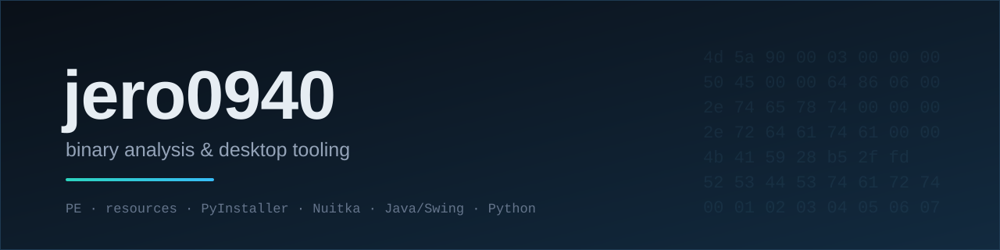



  

**Herramientas para entender qué lleva dentro un ejecutable** 
*Tools to understand what is inside an executable*

---

## 🇪🇸 Español

Diseño y construyo **herramientas de escritorio** para analizar binarios y automatizar trabajo repetitivo. Me interesa lo que otros dan por caja negra: un `.exe` que «hace cosas» hasta que lo abres y ves sus secciones, sus recursos y los archivos que lleva dentro.

### Qué hago

- **Análisis de ejecutables Windows (PE)** — cabecera, secciones, permisos, recursos, overlay y firmas embebidas, sin ejecutar el binario.
- **Desempaquetado** — PyInstaller (CArchive y PYZ), Nuitka onefile (payload zstd), ZIP, CAB, gzip, bzip2, xz.
- **Reverso de ofuscación** — base64 por capas, compresión y ofuscadores de Python, JavaScript y PHP.
- **Interfaces de escritorio** — Java/Swing sin dependencias externas, empaquetadas en un JAR.

### Proyectos

| Proyecto | Qué es | Stack |
|---|---|---|
| **Cofre Pro** | Desofuscador con ventana Java y motor Python. Analiza y revierte ofuscación reversible, y abre `.exe`: secciones, recursos, guiones embebidos, PyInstaller y Nuitka onefile. 23 + 183 comprobaciones automáticas. | Java 21 · Swing · Python · PE |
| **CodeShield** | Ofuscador multi-lenguaje (Python, JavaScript y PHP) y su reverso, con formato binario propio y verificación por checksum. | Python · JavaScript · PHP |

> Los repositorios de proyectos son **privados por ahora**. Si necesitas ver el código o una demostración, abre un [issue](https://github.com/jero0940/jero0940/issues).

### Cómo trabajo

1. **Solo lectura** sobre binarios ajenos: nada se modifica y nada se ejecuta sin permiso.
2. **Evidencia antes que opinión**: cada dato lleva su offset, su tamaño y su SHA-256.
3. **Pruebas contra algo independiente**, no contra el propio motor: si dos implementaciones no coinciden, la prueba falla.
4. **Límites claros**: si falta un motor, se dice y se da el comando exacto; no se simula una capacidad.

---

## 🇬🇧 English

I build **desktop tools** for binary analysis and automation. I care about the things people treat as a black box: an `.exe` that "does stuff" until you open it and see its sections, its resources and the files it carries inside.

**What I do**

- **Windows PE analysis** — headers, sections, permissions, resources, overlay and embedded signatures, without running the binary.
- **Unpacking** — PyInstaller (CArchive and PYZ), Nuitka onefile (zstd payload), ZIP, CAB, gzip, bzip2, xz.
- **De-obfuscation** — layered base64, compression, and Python/JavaScript/PHP obfuscators.
- **Desktop UIs** — dependency-free Java/Swing, shipped as a single JAR.

**Projects**

| Project | What it is | Stack |
|---|---|---|
| **Cofre Pro** | De-obfuscator with a Java UI and a Python engine. Inspects and unpacks `.exe` files: sections, resources, embedded scripts, PyInstaller and Nuitka onefile. 23 + 183 automated checks. | Java 21 · Swing · Python · PE |
| **CodeShield** | Multi-language obfuscator (Python, JavaScript, PHP) and its reverse, with a custom binary format and checksum verification. | Python · JavaScript · PHP |

> Project repositories are **private for now**. If you need to see the code or a demo, open an [issue](https://github.com/jero0940/jero0940/issues).

**How I work**

1. **Read-only** on third-party binaries: nothing is modified, nothing runs without permission.
2. **Evidence over opinion**: every claim comes with its offset, size and SHA-256.
3. **Tests against an independent implementation**, not against the engine itself.
4. **Honest limits**: if an engine is missing, I say so and give the exact command. No simulated capabilities.

---

  Perfil sin datos personales, a propósito · Profile with no personal data, on purpose

